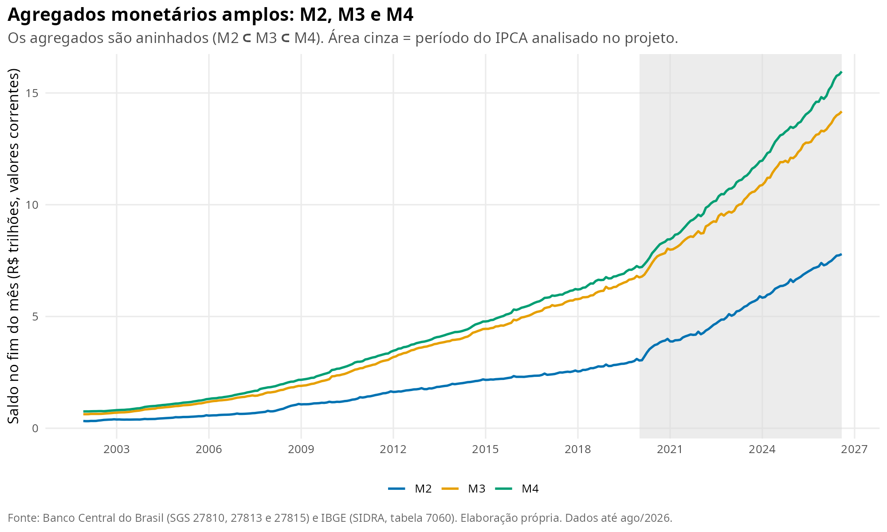
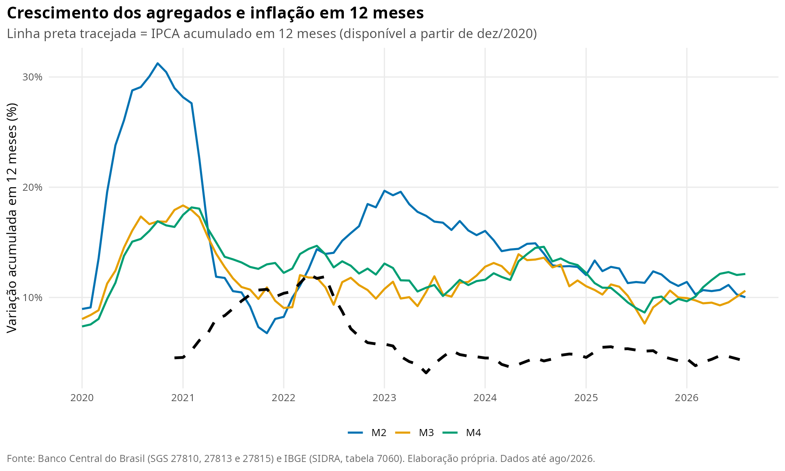
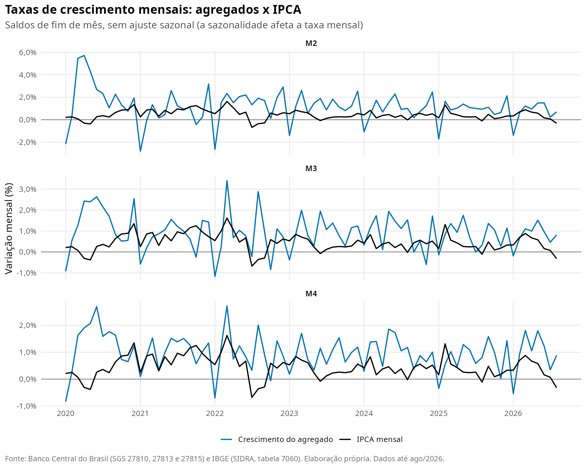
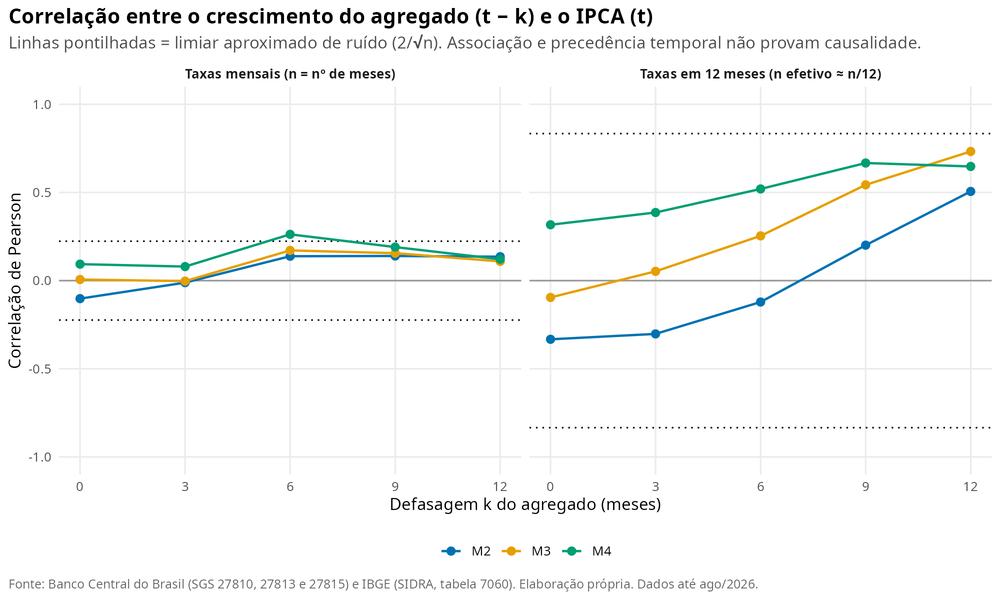
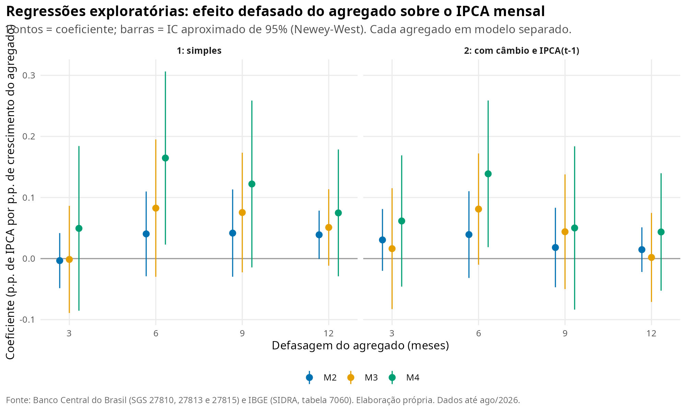

```{r setup}
library(tidyverse); library(lubridate); library(knitr)

need <- c("data/processed/ipca_indices.csv", "outputs/tables/ranking_grupos.csv",
          "outputs/tables/estatisticas_geral.csv", "outputs/tables/picos_mensais_geral.csv",
          "outputs/tables/picos_mensais_grupos.csv", "outputs/tables/sazonalidade.csv",
          "outputs/tables/contribuicao_grupos.csv", "outputs/tables/validacao_contribuicao.csv",
          "outputs/tables/comparacao_alimentacao_geral.csv", "outputs/tables/validacao_acumulados.csv",
          "outputs/tables/correlacao_peso_aumento.csv")
if (!all(file.exists(need))) stop("Rode antes os scripts R/01 a R/04 (veja o README).")

rd <- function(f) read_csv(f, show_col_types = FALSE)
ind <- rd(need[1]); rk <- rd(need[2]); est <- rd(need[3]); picos <- rd(need[4]); picos_g <- rd(need[5])
saz <- rd(need[6]); cg <- rd(need[7]); chk <- rd(need[8]); comp <- rd(need[9]); vala <- rd(need[10]); cor_pa <- rd(need[11])

meses_pt <- c("jan","fev","mar","abr","mai","jun","jul","ago","set","out","nov","dez")
fm <- function(d) paste0(meses_pt[month(d)], "/", year(d))
f  <- function(x, d = 2) formatC(x, format = "f", digits = d, decimal.mark = ",", big.mark = ".")

meta <- jsonlite::read_json(tail(sort(list.files("data/raw", "^sidra_7060_meta_", full.names = TRUE)), 1))
coleta <- format(as.Date(substr(meta$data_coleta, 1, 10)), "%d/%m/%Y")

ini <- min(ind$data); fim <- max(ind$data)
base_dt <- seq(ini, by = "-1 month", length.out = 2)[2]
geral <- filter(ind, tipo == "geral")
pos_al <- which(str_detect(rk$grupo, "^Alimenta")); al <- rk[pos_al, ]
ultimo <- comp[nrow(comp), ]
dif_max <- comp[which.max(comp$diferenca_indice), ]
pico12 <- geral[which.max(geral$acum_12m), ]
need_h <- c("outputs/tables/veredito_hipoteses.csv", "outputs/tables/h2_criterios.csv", "outputs/tables/h2_educacao_itens_fevereiro.csv",
            "outputs/tables/h1_criterios.csv", "outputs/tables/h1_picos_resumo.csv", "outputs/tables/h1_picos_itens.csv",
            "outputs/tables/h3_resumo.csv", "outputs/tables/h3_livres_monitorados.csv", "outputs/tables/h3_correlacao_cambio.csv", "outputs/tables/h1_concentracao_resumo.csv", "outputs/tables/h1_picos_grupos.csv")
if (!all(file.exists(need_h))) stop("Rode antes os scripts R/05 a R/08 (veja o README).")
vh <- rd(need_h[1]); h2c <- rd(need_h[2]); h2i <- rd(need_h[3]); h1c <- rd(need_h[4]); h1p <- rd(need_h[5])
h1i <- rd(need_h[6]); h3r <- rd(need_h[7]); h3l <- rd(need_h[8]); h3c <- rd(need_h[9]); h1b <- rd(need_h[10]); h1g <- rd(need_h[11])
fp <- function(x, d = 0) ifelse(is.na(x), "não avaliável", paste0(f(100 * x, d), "%"))
sn <- function(x) ifelse(is.na(x), "não avaliável", ifelse(x, "Sim", "Não"))
melhor <- h3c |> slice_max(abs(correlacao), n = 1, with_ties = FALSE)
h1_grp <- h1g |> group_by(grupo) |> summarise(media = mean(share_var_geral), .groups = "drop") |> arrange(desc(media))
saz_g <- filter(saz, grupo == "IPCA geral")
mes_alto <- slice_max(saz_g, media, n = 3); mes_baixo <- slice_min(saz_g, media, n = 2)
top5 <- head(picos_g, 5)
n_edu_fev <- sum(top5$grupo == "Educação" & month(top5$data) == 2)
soma_contrib <- sum(cg$soma_contrib_pp)
```

## Resumo

Este projeto usa dados oficiais do IBGE para investigar quais grupos de consumo mais encareceram no Brasil entre `r fm(ini)` e `r fm(fim)` e como sua evolução se compara ao IPCA geral. No período, o IPCA geral acumulou **`r f(est$aumento_acum_pct, 1)`%**, calculado pela composição das variações mensais. **`r al$grupo`** foi o grupo que mais encareceu (**`r f(al$aumento_acum_pct, 1)`%**), enquanto **`r rk$grupo[nrow(rk)]`** foi o que menos subiu (**`r f(rk$aumento_acum_pct[nrow(rk)], 1)`%**).

## Pergunta de pesquisa

> Quais grupos de consumo mais encareceram no Brasil desde 2020, e como sua evolução se compara à inflação geral medida pelo IPCA?

Perguntas secundárias: como a inflação mensal evoluiu, quando ocorreram os maiores picos, se há padrões sazonais aparentes, qual o peso de cada grupo e quanto cada um contribuiu para a inflação geral.

## Dados e metodologia

**Fonte:** IBGE, SIDRA, tabela 7060 (IPCA), obtida pela API oficial. **Coleta:** `r coleta`. **Período:** `r fm(ini)` a `r fm(fim)` (`r nrow(geral)` meses). Foram usados o índice geral e os nove grupos principais; subgrupos e itens foram usados apenas na seção de hipóteses, sem misturar níveis nas comparações principais.

Cinco conceitos distintos aparecem neste relatório:

- **Variação mensal:** quanto os preços variaram em um mês.
- **Acumulada no ano e em 12 meses:** variações mensais *compostas* dentro dessas janelas.
- **Índice de preços:** é construído como

  `Índice = 100 × (1 + v₁/100) × (1 + v₂/100) × … × (1 + vₜ/100)`

  em que *v* é a variação mensal em %. A base 100 corresponde a **`r fm(base_dt)`**, o mês anterior ao início da série. Um índice de 144,7 significa que os preços estão 44,7% acima da base. O **aumento acumulado** é o índice final menos 100. Variações mensais não são somadas, porque os percentuais incidem uns sobre os outros (1% + 1% resulta em 2,01%).
- **Peso:** participação do grupo na cesta de consumo (%).
- **Contribuição (em pontos percentuais, p.p.):** parcela da variação do IPCA atribuível a um grupo. Aqui é estimada de forma simplificada: `peso × variação / 100`.

**Limpeza.** Os nomes das variáveis foram padronizados e as datas e os valores, convertidos. O SIDRA usa `...` para dados que não existem; esses valores viram `NA` e não foram removidos. Eles aparecem só no acumulado em 12 meses dos primeiros 11 meses da série, que não pode ser calculado sem dados anteriores a 2020. Não há duplicatas, e as quatro variáveis têm cobertura completa para os dez agregados. Os acumulados foram recalculados a partir das variações mensais e comparados com os publicados pelo IBGE: a maior diferença absoluta em 12 meses foi de `r f(max(vala$max_abs_dif_12m_pp), 2)` p.p., compatível com arredondamento a duas casas.

## Análise exploratória

### Inflação mensal do IPCA geral

```{r}
est |>
  transmute(Média = f(media), Mediana = f(mediana), `Desvio-padrão` = f(desvio_padrao),
            Máxima = paste0(f(maximo), " (", fm(mes_maximo), ")"),
            Mínima = paste0(f(minimo), " (", fm(mes_minimo), ")")) |>
  kable(caption = "Variação mensal do IPCA geral (%)")
```


O gráfico mostra a trajetória mês a mês; valores abaixo de zero indicam deflação no mês. O acumulado em 12 meses atingiu seu maior valor em **`r fm(pico12$data)`**, com **`r f(pico12$acum_12m)`%**.

```{r}
picos |>
  transmute(Mês = fm(data), `Variação mensal (%)` = f(var_mensal), `Acumulado 12 meses (%)` = f(acum_12m)) |>
  kable(caption = "10 maiores variações mensais do IPCA geral")
```

### Evolução dos preços por grupo


Cada linha mostra quanto os preços do grupo acumularam desde a base. Quanto mais inclinada a linha, mais rápido o grupo encareceu. A linha preta tracejada é o IPCA geral: grupos acima dela encareceram mais que a média; abaixo, menos.

### Ranking de aumento acumulado


```{r}
rk |>
  transmute(Posição = posicao, Grupo = grupo, `Aumento acumulado (%)` = f(aumento_acum_pct, 1),
            `Peso médio (%)` = f(peso_medio, 1), `Acima do IPCA geral` = ifelse(acima_do_geral, "Sim", "Não")) |>
  kable(caption = paste0("Aumento acumulado de ", fm(ini), " a ", fm(fim)))
```

**Alimentação e bebidas** ficou na posição **`r pos_al`** de 9, com aumento acumulado de **`r f(al$aumento_acum_pct, 1)`%**, contra **`r f(est$aumento_acum_pct, 1)`%** do IPCA geral. Ao final da série, o índice de Alimentação e bebidas estava em `r f(ultimo$indice_alim, 1)` e o geral em `r f(ultimo$indice_geral, 1)`. Alimentação superou o IPCA geral em `r sum(comp$alim_acima_no_mes)` de `r nrow(comp)` meses (`r f(100 * mean(comp$alim_acima_no_mes), 0)`%). A distância entre os dois índices atingiu o máximo de `r f(dif_max$diferenca_indice, 1)` pontos em `r fm(dif_max$data)`.

### Padrões sazonais aparentes


Cada linha é um ano e cada coluna, um mês; vermelho indica inflação positiva, azul indica queda, e células cinza são meses ainda não divulgados. Colunas que se repetem em tom parecido ao longo dos anos sugerem sazonalidade.

```{r}
saz_g |>
  transmute(Mês = meses_pt[mes], Anos = n_anos, `Média (%)` = f(media), `Mediana (%)` = f(mediana),
            `Mín. (%)` = f(minimo), `Máx. (%)` = f(maximo)) |>
  kable(caption = "Variação mensal do IPCA geral por mês do calendário")
```

As maiores médias ocorrem em **`r paste(meses_pt[mes_alto$mes], collapse = ", ")`** e as menores em **`r paste(meses_pt[mes_baixo$mes], collapse = " e ")`**. Entre as cinco maiores variações mensais de grupos individuais, `r n_edu_fev` são de Educação em fevereiro. Como há apenas seis ou sete observações por mês e a amplitude entre mínimo e máximo é grande, esses padrões são **indícios**, não conclusões estatísticas.

### Peso e contribuição


```{r}
cg |>
  transmute(Grupo = grupo, `Peso médio (%)` = f(peso_medio, 1),
            `Contribuição acum. aprox. (p.p.)` = f(soma_contrib_pp, 1),
            `Participação (%)` = f(participacao_pct, 1), `Aumento acumulado (%)` = f(aumento_acum_pct, 1)) |>
  kable()
```

Peso, variação e contribuição respondem a perguntas diferentes. O peso diz quanto do orçamento o grupo representa; a variação diz quanto seus preços subiram; a contribuição combina as duas coisas. Comunicação, por exemplo, tem peso médio de `r f(cg$peso_medio[cg$grupo == "Comunicação"], 1)`%, mas contribuiu pouco porque seus preços subiram pouco.

**Limitação importante.** A estimativa soma, mês a mês, `peso × variação / 100`. Por mês, ela reproduz o IPCA geral com resíduo máximo de `r f(max(abs(chk$residuo_pp)), 3)` p.p. Porém, somar contribuições mensais não equivale à contribuição composta oficial do IBGE: a soma de todos os grupos aqui é de `r f(soma_contrib, 1)` p.p., enquanto o aumento acumulado composto do IPCA é de `r f(est$aumento_acum_pct, 1)`%. A coluna "Participação" serve para comparar grupos entre si, mas os valores em p.p. não somam o acumulado composto.

A correlação de Spearman entre peso médio e aumento acumulado é de `r f(cor_pa$correlacao_spearman_peso_x_aumento, 2)`, calculada com apenas `r cor_pa$n_grupos` grupos. É uma medida descritiva, sem força para sustentar conclusões.

## Investigação das hipóteses

Para ir além da descrição, as três hipóteses foram transformadas em **previsões que podem falhar**, com limiares definidos antes de olhar os resultados (são escolhas de julgamento, não regras estatísticas; estão em `R/07_hipoteses.R`). Foram coletados dados adicionais: IPCA por subgrupo e item (IBGE/SIDRA, tabela 7060) e séries do Banco Central (SGS: câmbio, preços livres e monitorados). **"Consistente" significa que os dados não contradizem a hipótese; não significa que ela esteja provada.**

```{r}
vh |> transmute(Hipótese = hipotese, Veredito = veredito, Observação = observacao) |> kable()
```

### H2: Educação em fevereiro e reajuste de mensalidades

**Previsão.** Se o salto vem de reajustes de mensalidades, fevereiro deve ser o mês de maior alta de Educação na maioria dos anos, deve responder pela maior parte da alta anual e deve se concentrar no item de cursos regulares.

```{r}
h2c |> transmute(Critério = criterio, Resultado = fp(valor), Limiar = fp(limiar), Atendido = sn(atendido)) |> kable()
```

Fevereiro foi o mês de maior alta de Educação em `r fp(h2c$valor[1])` dos anos; a mediana da razão entre a alta de fevereiro e a alta do ano foi de `r fp(h2c$valor[2])`; e o item "Cursos regulares" respondeu por `r fp(h2c$valor[3])` da contribuição de fevereiro entre os itens de Educação. Veredito: **`r vh$veredito[2]`**.

```{r}
h2i |> filter(nivel == 4) |>
  transmute(Item = nome, `Peso médio (%)` = f(peso_medio, 1), `Var. média em fev. (%)` = f(var_media_fev),
            `Var. média nos demais meses (%)` = f(var_media_demais_meses), `Participação na contribuição de fev.` = fp(participacao_fev)) |>
  kable(caption = "Itens de Educação")
```

```{r}
#| fig-cap: "Educação: variação mensal por mês do calendário"
knitr::include_graphics("outputs/figures/06_h2_educacao_por_mes.png")
```

```{r}
#| fig-cap: "Contribuição dos itens de Educação em fevereiro"
knitr::include_graphics("outputs/figures/07_h2_educacao_fevereiro_itens.png")
```

O teste usa só dados do IBGE. Ele mostra *onde* o salto acontece, mas o mecanismo (reajuste de mensalidades) deve ser confirmado na metodologia do IBGE.

### H1: choques de oferta e de custos nos picos

**Previsão.** Nos cinco maiores picos do IPCA, a alta deve estar concentrada em poucos itens, e Alimentação e Transportes devem explicar a maior parte dela.

```{r}
h1p |> transmute(Mês = fm(data), `Alta do IPCA (%)` = f(var_geral),
                 `5 maiores itens (% da alta)` = f(100 * share_top5, 0),
                 `Alimentação + Transportes (% da alta)` = f(100 * share_alim_transp, 0)) |> kable()
```

Em `r fp(h1c$valor[1])` dos picos os cinco maiores itens explicam pelo menos metade da alta, e em `r fp(h1c$valor[2])` dos picos Alimentação e Transportes explicam pelo menos metade (limiar de `r fp(h1c$limiar[1])` dos picos em cada critério). Veredito: **`r vh$veredito[1]`**.

**Verificações adicionais (robustez).** A fatia das contribuições positivas explicada pelos cinco maiores itens foi, em mediana, de `r fp(h1b$mediana_picos)` nos picos e de `r fp(h1b$mediana_todos_meses)` em todos os meses; se os valores forem próximos, a concentração nos picos não é uma característica especial deles. Por grupo, a maior participação média na alta dos picos foi de `r paste(h1_grp$grupo[1:3], collapse = "; ")` (`r paste(f(100 * h1_grp$media[1:3], 0), collapse = "%; ")`%). Portanto, o critério "Alimentação + Transportes" pode ser atendido principalmente por um dos dois grupos; veja os itens líderes abaixo antes de concluir.

```{r}
h1i |> filter(rank <= 3) |>
  transmute(Mês = fm(data), Posição = rank, Item = nome, Grupo = grupo, `Contribuição (p.p.)` = f(contrib_pp)) |>
  kable(caption = "Três itens de maior contribuição em cada pico")
```

```{r}
#| fig-cap: "Principais itens nos cinco maiores picos do IPCA"
knitr::include_graphics("outputs/figures/08_h1_picos_itens.png")
```

Este teste verifica a **concentração** da alta, não a **causa**. Afirmar que houve choque de oferta ou de custos exige evidência externa (notas do IBGE de cada mês, preços de commodities e combustíveis), que não foi coletada.

### H3: câmbio, preços livres e administrados

Aqui a análise é apenas descritiva. Os preços monitorados (administrados) acumularam `r f(h3r$valor[3], 1)`% no período e os preços livres, `r f(h3r$valor[2], 1)`%, contra `r f(h3r$valor[1], 1)`% do IPCA geral. No acumulado do período os dois ficaram muito próximos, mas dentro de um mesmo ano a diferença entre eles chegou a `r f(max(abs(h3l$livres[h3l$ano != "Período todo"] - h3l$monitorados[h3l$ano != "Período todo"])), 1)` p.p. Explicar essas divergências exige informação sobre os itens monitorados e sobre eventuais medidas de política de preços, que não foram analisadas aqui.

```{r}
h3l |> transmute(Ano = ano, Meses = meses, `IPCA geral (%)` = f(geral), `Livres (%)` = f(livres), `Monitorados (%)` = f(monitorados)) |>
  kable(caption = "Inflação acumulada (composta) por ano")
```

```{r}
#| fig-cap: "Preços livres e monitorados"
knitr::include_graphics("outputs/figures/09_h3_livres_monitorados.png")
```

Foram calculadas correlações entre a inflação mensal de cada grupo e a variação mensal do câmbio (média mensal do dólar), com defasagens de 0 a 6 meses. Das `r h3r$valor[5]` correlações, `r h3r$valor[4]` ficaram acima do limiar aproximado de ruído (2/√n), contra cerca de `r f(h3r$valor[6], 1)` esperadas só por acaso (e os grupos são correlacionados entre si, então o número efetivo de testes independentes é menor). A maior correlação absoluta foi `r f(melhor$correlacao)`, entre **`r melhor$grupo`** e o câmbio defasado em `r melhor$defasagem_meses` meses, o que corresponde a cerca de `r f(100 * melhor$correlacao^2, 0)`% da variação mensal do grupo.`r ifelse(melhor$defasagem_meses == max(h3c$defasagem_meses), " Como essa é a maior defasagem testada, o resultado merece cautela: a relação pode se estender a defasagens maiores ou ser acaso.", "")` Veredito: **`r vh$veredito[3]`**.

```{r}
#| fig-cap: "Correlação entre inflação dos grupos e variação do câmbio"
knitr::include_graphics("outputs/figures/10_h3_correlacao_cambio.png")
```

Com 81 meses, muitos testes simultâneos, sem controles e com variáveis correlacionadas entre si, esse resultado **não identifica causalidade**.

## Agregados monetários (M2, M3 e M4) e inflação

Esta seção investiga se o crescimento dos meios de pagamento amplos acompanha ou antecede o IPCA. Três conceitos são mantidos separados ao longo do texto: **associação estatística** (as séries se movem juntas), **precedência temporal** (uma série se move antes da outra) e **causalidade econômica** (uma série provoca a outra). Os métodos usados aqui podem mostrar as duas primeiras, mas não a terceira.

```{r}
#| include: false
need_m <- c("outputs/tables/m_validacao.csv", "outputs/tables/m_resumo_crescimento.csv", "outputs/tables/m_correlacoes_defasagens.csv",
            "outputs/tables/m_correlacoes_subperiodos.csv", "outputs/tables/m_correlacao_entre_agregados.csv",
            "outputs/tables/m_estacionariedade.csv", "outputs/tables/m_regressoes.csv", "outputs/tables/m_granger.csv")
if (!all(file.exists(need_m))) stop("Rode antes: Rscript R/06_coleta_bcb.R monetarios, R/09_monetarios.R e R/10_visualizacoes_monetarios.R (veja o README).")
mv <- rd(need_m[1]); mr <- rd(need_m[2]); mc <- rd(need_m[3]); ms <- rd(need_m[4]); ma <- rd(need_m[5]); me <- rd(need_m[6]); mg <- rd(need_m[7]); mgc <- rd(need_m[8])
ini_m <- min(mr$janela_inicio); fim_m <- max(mr$janela_fim); ult_m <- max(mv$ultimo_mes)
tab_cor <- function(tp) mc |> filter(tipo == tp) |> mutate(r = paste0(f(pearson), ifelse(acima_limiar, "*", ""))) |>
  select(Agregado = agregado, defasagem_meses, r) |> pivot_wider(names_from = defasagem_meses, values_from = r, names_prefix = "k = ")
cmp <- filter(mc, tipo == "mensal", defasagem_meses > 0)
n_ac <- sum(cmp$acima_limiar); n_tot <- nrow(cmp); melhor_m <- slice_max(cmp, abs(pearson), n = 1, with_ties = FALSE)
reg_x <- filter(mg, termo == "x"); n_sig <- sum(reg_x$p_aprox < 0.05); n_reg <- nrow(reg_x)
g_ip <- filter(mgc, direcao == "agregado -> IPCA"); g_ag <- filter(mgc, direcao == "IPCA -> agregado")
nao_est <- me$serie[!me$rejeita_raiz_unitaria_5pct]
```

### Dados e definições

```{r}
tibble(Agregado = c("M2", "M3", "M4"),
       `Definição (Banco Central)` = c("M1 + depósitos de poupança + títulos privados emitidos por instituições depositárias",
                                        "M2 + quotas de fundos de investimento depositários + operações compromissadas com títulos públicos e privados",
                                        "M3 + títulos públicos emitidos pelo Governo Federal"),
       `Série SGS` = c("27810", "27813", "27815")) |> kable()
```

São as séries "Novo" dos meios de pagamento amplos (BCB/SGS): mensais, saldo em final de período, em milhares de reais correntes, com revisão histórica desde dez/2001. Os dados vão até `r fm(ult_m)`; a análise com o IPCA cobre `r fm(ini_m)` a `r fm(fim_m)`, o período do IPCA já usado no projeto. Como **M2 ⊂ M3 ⊂ M4**, os agregados têm componentes sobrepostos: seus resultados não são evidências independentes entre si, e nenhum modelo inclui dois agregados ao mesmo tempo. As séries estão completas (sem meses faltando) e `r ifelse(mv$violacoes_hierarquia_M2_M3_M4[1] == 0, "respeitam M2 ≤ M3 ≤ M4 em todos os meses", paste0("violam M2 ≤ M3 ≤ M4 em ", mv$violacoes_hierarquia_M2_M3_M4[1], " meses (conferir)"))`.

### Evolução dos agregados



```{r}
mr |> transmute(Agregado = agregado, `Saldo final (R$ tri)` = f(saldo_final_tri, 2), `Crescimento nominal na janela (%)` = f(acumulado_pct, 1),
                `IPCA na janela (%)` = f(ipca_acumulado_pct, 1), `Crescimento real (%)` = f(acumulado_real_pct, 1),
                `Média mensal (%)` = f(media_mensal), `Máx. em 12 meses (%)` = paste0(f(max_12m, 1), " (", fm(mes_max_12m), ")"),
                `Último 12 meses (%)` = f(ultimo_12m, 1)) |> kable(caption = "Crescimento dos agregados e IPCA na janela da análise")
```

O crescimento "real" é o nominal deflacionado pelo IPCA acumulado do mesmo período; descreve o poder de compra do saldo, não uma relação de causa com a inflação.

### Crescimento mensal e em 12 meses frente ao IPCA





As taxas em 12 meses suavizam o ruído e a sazonalidade, mas **sobrepõem janelas** (cada mês entra em doze taxas), o que cria forte autocorrelação e reduz muito o número efetivo de observações. Por isso elas são usadas para descrever, e a inferência se apoia nas taxas mensais. Os saldos não são dessazonalizados, então a taxa mensal pode conter efeitos sazonais.

### Correlações com defasagens de 3, 6, 9 e 12 meses

Cada célula é a correlação entre o crescimento do agregado em *t − k* e o IPCA em *t* (k = 0 é a referência contemporânea). O asterisco (\*) marca correlações acima do limiar aproximado de ruído, 2/√n (com n efetivo ≈ n/12 nas taxas em 12 meses).

```{r}
kable(tab_cor("mensal"), caption = "Taxas mensais: correlação de Pearson")
```

```{r}
kable(tab_cor("12m"), caption = "Taxas em 12 meses (descritiva; observações sobrepostas)")
```



Entre as taxas mensais com defasagem positiva, `r n_ac` de `r n_tot` correlações superaram o limiar de ruído (cerca de `r f(0.05 * n_tot, 1)` esperadas só por acaso, e os agregados são correlacionados entre si). A maior correlação absoluta foi `r f(melhor_m$pearson)`, para o **`r melhor_m$agregado`** com defasagem de `r melhor_m$defasagem_meses` meses (n = `r melhor_m$n`), o que corresponde a cerca de `r f(100 * melhor_m$pearson^2, 1)`% da variância linear do IPCA mensal.

```{r}
ms |> filter(defasagem_meses > 0) |> transmute(Período = periodo, Agregado = agregado, k = defasagem_meses, r = f(pearson)) |>
  pivot_wider(names_from = k, values_from = r, names_prefix = "k = ") |> kable(caption = "Taxas mensais: correlação por subperíodo")
```

Se o sinal ou o tamanho das correlações muda entre subperíodos (`r min(ms$n)` a `r max(ms$n)` observações cada), a relação não é estável no tempo, o que enfraquece qualquer leitura causal simples. As taxas mensais dos agregados são correlacionadas entre si (entre `r f(min(ma$correlacao[ma$tipo == "mensal"]))` e `r f(max(ma$correlacao[ma$tipo == "mensal"]))`), consequência direta da sobreposição de componentes.

### Estacionariedade e regressões exploratórias

Antes de regredir, uma triagem de estacionariedade (Dickey-Fuller aumentado, com constante e 3 defasagens). O teste tem baixo poder com amostras deste tamanho; serve só como alerta.

```{r}
me |> transmute(Série = serie, n, `t (ADF)` = f(t_adf), `Crítico 5%` = f(critico_5pct), `Rejeita raiz unitária` = ifelse(rejeita_raiz_unitaria_5pct, "Sim", "Não")) |> kable()
```

Séries em que **não** se rejeitou raiz unitária a 5%: `r if (length(nao_est)) paste(nao_est, collapse = ", ") else "nenhuma"`. Regressões entre séries não estacionárias podem ser espúrias; por isso os modelos usam as **taxas mensais** (variações), não os níveis nem as taxas em 12 meses.

Os modelos explicam o IPCA mensal pelo crescimento mensal do agregado defasado em *k* meses. O modelo 1 é simples; o modelo 2 acrescenta o câmbio defasado e o IPCA do mês anterior como controles parciais. Os erros-padrão são robustos a autocorrelação e heteroscedasticidade (Newey-West), com p-valores aproximados pela distribuição normal.

```{r}
reg_x |> transmute(Modelo = modelo, Agregado = agregado, `Defasagem (meses)` = defasagem_meses, n, Coeficiente = f(coef, 3),
                   `EP (HAC)` = f(ep_hac, 3), `p (aprox.)` = f(p_aprox, 3), `R²` = f(r2, 3)) |>
  kable(caption = "Coeficiente do crescimento mensal do agregado (p.p. de IPCA por p.p. de crescimento)")
```



`r n_sig` de `r n_reg` coeficientes tiveram p aproximado abaixo de 0,05, contra cerca de `r f(0.05 * n_reg, 1)` esperados só por acaso (e as especificações não são independentes). O R² mais alto foi de `r f(max(reg_x$r2), 3)`.

Para a **precedência temporal**, foram feitos testes do tipo Granger (teste F de que as defasagens de uma série acrescentam informação à previsão da outra), nos dois sentidos, com 3 e 6 defasagens.

```{r}
mgc |> transmute(Direção = direcao, Agregado = agregado, Defasagens = p_defasagens, n, `Estatística F` = f(F), `p-valor` = f(p_valor, 3)) |> kable()
```

No sentido agregado → IPCA, `r sum(g_ip$p_valor < 0.05)` de `r nrow(g_ip)` testes ficaram abaixo de 0,05; no sentido IPCA → agregado, `r sum(g_ag$p_valor < 0.05)` de `r nrow(g_ag)`. A "causalidade de Granger" é apenas capacidade preditiva incremental: não identifica causa econômica, e uma terceira variável (por exemplo, a taxa de juros ou o câmbio) pode explicar os dois movimentos.

### Como interpretar estes resultados

- **Associação.** Correlações e coeficientes medem comovimento linear. Podem surgir de um fator comum, de coincidência em amostras curtas ou de testes múltiplos.
- **Precedência temporal.** Um agregado que "antecede" o IPCA estatisticamente é compatível com, mas não prova, um efeito monetário. A própria inflação pode preceder o crescimento nominal dos agregados (a demanda por moeda nominal se ajusta aos preços); por isso o teste foi feito nos dois sentidos.
- **Causalidade econômica.** Exigiria identificação (por exemplo, choques monetários exógenos, instrumentos ou modelos estruturais) e controle de outros determinantes. Isso está fora do escopo deste projeto.

**Possíveis fatores de confusão (não controlados, ou controlados só em parte):** taxa básica de juros e operações compromissadas (que compõem o M3); política fiscal e emissão de títulos públicos (que compõem o M4); câmbio (apenas um controle parcial no modelo 2); atividade econômica e hiato do produto; choques de oferta em alimentos, energia e combustíveis; preços administrados; expectativas de inflação; o choque da pandemia, que pode ter alterado a demanda por ativos líquidos e a velocidade de circulação da moeda; migração de recursos entre poupança, fundos e títulos, que muda a composição entre M2, M3 e M4 sem alterar a liquidez total; e a sazonalidade das taxas mensais.

**Limitações específicas.** A amostra do IPCA do projeto é curta (a partir de `r fm(ini_m)`) e dominada por poucos episódios; as correlações têm intervalo largo; M2, M3 e M4 não são independentes; os modelos são lineares e não consideram mudanças de regime; as taxas em 12 meses sobrepõem janelas; e o conjunto de testes é grande em relação ao tamanho da amostra.

## Principais resultados

- **Maiores aumentos acumulados:** `r paste(rk$grupo[1:3], collapse = "; ")`.
- **Menores aumentos acumulados:** `r paste(rev(tail(rk$grupo, 3)), collapse = "; ")`.
- **Alimentação e bebidas** encareceu `r f(al$aumento_acum_pct - est$aumento_acum_pct, 1)` p.p. a mais que o IPCA geral no acumulado do período.
- **Picos:** a maior variação mensal do IPCA geral foi de `r f(est$maximo)`% (`r fm(est$mes_maximo)`) e a menor, de `r f(est$minimo)`% (`r fm(est$mes_minimo)`).
- **Contribuição aproximada:** os três grupos com maior contribuição foram `r paste(cg$grupo[1:3], collapse = "; ")`, responsáveis por `r f(sum(cg$participacao_pct[1:3]), 0)`% do total estimado.

## Conclusões econômicas

**O que os dados mostram.** Alimentação e bebidas foi o grupo que mais encareceu no período e também o de maior contribuição estimada para a inflação, combinando alta variação e alto peso. As cinco maiores variações mensais do IPCA geral ocorreram em `r paste0(paste(head(fm(sort(picos$data[1:5])), 4), collapse = ", "), " e ", fm(sort(picos$data[1:5]))[5])`, e o acumulado em 12 meses chegou a `r f(pico12$acum_12m)`% em `r fm(pico12$data)`. Comunicação ficou muito abaixo dos demais grupos.

**Hipóteses (testadas de forma exploratória).** Os resultados completos estão na seção "Investigação das hipóteses"; os vereditos significam apenas que os dados não contradizem (ou contradizem) cada hipótese:

- **H1, choques de oferta e de custos nos picos:** `r vh$veredito[1]`. A causa não foi testada; exige evidência externa.
- **H2, Educação em fevereiro:** `r vh$veredito[2]`. O mecanismo de reajuste de mensalidades deve ser confirmado na metodologia do IBGE.
- **H3, câmbio, preços livres e administrados:** `r vh$veredito[3]`. Análise descritiva, sem controle de outros fatores.

**Agregados monetários.** Na janela analisada, `r n_ac` de `r n_tot` correlações defasadas (taxas mensais) superaram o limiar de ruído e `r n_sig` de `r n_reg` coeficientes de regressão tiveram p aproximado abaixo de 0,05 (cerca de `r f(0.05 * n_reg, 1)` esperados por acaso). Esses resultados descrevem associação e precedência estatística; não permitem afirmar que a expansão monetária causou (ou não causou) a inflação.

Este relatório observa associações nos dados e não estabelece causalidade. Além disso, o IPCA é um índice agregado, calculado para famílias urbanas com rendimento de 1 a 40 salários mínimos; a inflação vivida por cada família depende da composição de seus gastos. Uma família que destina grande parte do orçamento a alimentação teve experiência diferente da média.

## Limitações

- Análise descritiva: não permite concluir causas, e correlações não implicam causalidade.
- A série cobre poucos anos e inclui choques atípicos; padrões sazonais e a correlação entre grupos (n = 9) são frágeis.
- A contribuição é uma aproximação simplificada, não o impacto oficial do IBGE.
- Grupos são agregados heterogêneos; médias escondem variações entre itens, subgrupos e regiões.
- Na análise monetária, a amostra é curta, os agregados M2, M3 e M4 são sobrepostos, as séries não são dessazonalizadas e há muitos testes simultâneos; os resultados são exploratórios e não identificam causalidade.
- Os limiares dos testes de hipóteses são escolhas de julgamento; com outros limiares os vereditos podem mudar. A contribuição por item usa a mesma aproximação simplificada.
- Os dados são de um único momento de coleta (`r coleta`) e podem ser revistos ou ampliados pelo IBGE.

## Referências

- IBGE. SIDRA, Tabela 7060: IPCA. <https://sidra.ibge.gov.br/tabela/7060>
- Banco Central do Brasil. Sistema Gerenciador de Séries Temporais (SGS), séries 1, 4449 e 11428. <https://dadosabertos.bcb.gov.br/>
- Banco Central do Brasil. Meios de pagamento amplos (saldo em final de período) - Novo: M2 (SGS 27810), M3 (SGS 27813) e M4 (SGS 27815). Catálogo de dados abertos: <https://dadosabertos.bcb.gov.br/>
- IBGE. IPCA, Índice Nacional de Preços ao Consumidor Amplo. <https://www.ibge.gov.br/estatisticas/economicas/precos-e-custos/9256-indice-nacional-de-precos-ao-consumidor-amplo.html>
